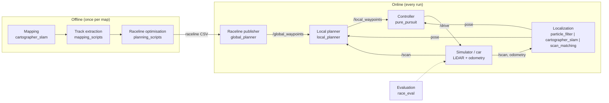

<div align="center">

# Autonomous Racing Platform: Perception, Planning, and Control Algorithm Design for Hardware Realization

**Keywords:** `robotics` `perception` `navigation` `control` `ros2`

</div>

---

## Abstract

A modular ROS 2 autonomy stack for autonomous racing on a 1/10-scale car (F1TENTH /
RoboRacer class), developed in simulation (f1tenth_gym) and deployed on a physical car.
The stack covers mapping a track, extracting the track geometry, optimising a raceline
offline, localizing the car on the map, adapting the raceline locally to the live LiDAR
scan, and tracking it with a path-following controller. Each block is a separate package
with a fixed topic interface. Scope: solo time trial (one car), with the map built in a
separate mapping run.

---

## System overview



| Stage | What it does | Package |
|---|---|---|
| Mapping | Drive the track once with a reactive controller; Cartographer builds the map | [`cartographer_slam`](code/localization/cartographer_slam), [`gap_follow`](code/reactive/gap_follow) / [`pid_wall`](code/reactive/pid_wall) |
| Track extraction | Map image → centreline + wall widths | [`mapping_scripts`](code/mapping_scripts) |
| Global planning | Centreline → optimised raceline + speed profile (QP, offline) | [`planning_scripts`](code/planning_scripts), [`global_planner`](code/global_planner) |
| Localization | Pose of the car on the map while racing | [`particle_filter`](code/localization/particle_filter), [`cartographer_slam`](code/localization/cartographer_slam), [`scan_matching`](code/localization/scan_matching) |
| Local planning | Check the raceline against the live scan; plan a local path where it lacks clearance | [`local_planner`](code/local_planner) |
| Control | Track the path: steering + speed | [`pure_pursuit`](code/pure_pursuit) |
| Evaluation | Log tracking against the raceline; plots | [`race_eval`](code/race_eval) |
| Simulation | One-command runs of any combination, with per-run logs | [`simulation_bringup`](code/simulation_bringup) |

Architecture details: [docs/02_architecture.md](docs/02_architecture.md).

### Implemented algorithms

| Stage | Algorithms |
|---|---|
| Global planning | shortest path, minimum curvature, iterative minimum curvature (QP, OSQP); friction-circle speed profile |
| Localization | particle filter (likelihood-field MCL, odometry-scale estimation, augmented-MCL recovery); Cartographer pure localization; PL-ICP scan matching |
| Local planning | pass-through, Frenet-frame sampling, RRT* with spline smoothing; scan-clearance gate |
| Control | pure pursuit with speed-scaled lookahead and understeer term |
| Reactive | Follow-the-Gap, PID wall following |

---

## Results

> **TODO**

## Demonstration

> **TODO**: sim and hardware recordings.

---

## Getting started

Environment: **Ubuntu 24.04**, **ROS 2 Jazzy**, Python packages (`ament_python`).

1. [Set up the workspace](docs/01_setup.md): simulator, this repository, dependencies, the
   simulator changes from [environment_changes.md](environment_changes.md).
2. Run the full stack with ground-truth pose:

```bash
ros2 launch simulation_bringup sim_bringup_launch.py
```

3. Try other combinations:

```bash
ros2 launch simulation_bringup sim_bringup_launch.py localization:=pf
ros2 launch simulation_bringup sim_bringup_launch.py localization:=carto odom_noise:=true planner:=rrt
ros2 launch simulation_bringup mapping_bringup_launch.py controller:=ftg max_speed:=3.0
```

Every run writes its logs, a lap summary and a rosbag to
`~/f1tenth_simulation_logs/<date_time>_<tag>/`. See
[docs/09_running_simulations.md](docs/09_running_simulations.md).

---

## Documentation

| # | Guide | Covers |
|---|---|---|
| 1 | [Setup](docs/01_setup.md) | workspace, simulator, dependencies, build |
| 2 | [Architecture](docs/02_architecture.md) | packages, topics, frames, design decisions |
| 3 | [Mapping](docs/03_mapping.md) | building a map with Cartographer |
| 4 | [Track extraction](docs/04_track_extraction.md) | map → centreline + widths |
| 5 | [Global planning](docs/05_global_planning.md) | raceline optimisation |
| 6 | [Localization](docs/06_localization.md) | the three localizers, odometry noise |
| 7 | [Local planning](docs/07_local_planning.md) | scan gate, Frenet, RRT* |
| 8 | [Control](docs/08_control.md) | pure pursuit, reactive controllers |
| 9 | [Running simulations](docs/09_running_simulations.md) | `simulation_bringup`, scenarios, views, logs |
| 10 | [Evaluation tools](docs/10_evaluation.md) | run logs, lap logger, plots |
| 11 | [Troubleshooting](docs/11_troubleshooting.md) | known issues |
| | [environment_changes.md](environment_changes.md) | every change made to the simulator |

Each package also has its own README (interface, parameters, usage) and can be read on its own.

---

## Repository structure

```text
code/                       ROS 2 packages and offline scripts (see code/README.md)
  race_msgs/                  raceline message definitions
  reactive/                   gap_follow, pid_wall: reactive controllers (no map)
  localization/               particle_filter, scan_matching, cartographer_slam
  odom_noise/                 drifting-odometry model for simulation
  mapping_scripts/            offline: map -> centreline + widths
  planning_scripts/           offline: centreline -> raceline
  global_planner/             publishes the raceline
  local_planner/              scan-aware local planning
  pure_pursuit/               path-tracking controller
  race_eval/                  lap logger + plotting script
  simulation_bringup/         one-command simulation and mapping runs
data/                       maps, extracted tracks, racelines (see data/README.md)
docs/                       guides, in pipeline order
media/                      figures and videos
hardware/                   BOM, CAD, wiring, PCB
report/                     thesis and presentation
simulation/                 simulation assets (the simulator itself is external)
environment_changes.md      changes made to the external simulator
```

The simulator (`f1tenth_gym`, `f1tenth_gym_ros`) and the race tracks
(`f1tenth_racetracks`) are external dependencies, cloned next to this repository; they
are not vendored here.

**Branches:** `main` holds the simulation stack. The physical car uses `hardware-dev`
(working branch) and `hardware-release` (only the packages that run on the Jetson), in a
separate workspace.

### Hardware platform

| Component | Details |
|---|---|
| Platform | HSP 94123 PRO, 1/10-scale brushless 4WD |
| Compute | NVIDIA Jetson Orin Nano |
| Sensors | Slamtec RPLiDAR C1M1-R2 (10 Hz, 12 m), ICM20947 IMU, VESC-derived (sensorless) odometry |
| Actuation | FLIPSKY FSESC 4.20 50A (VESC) |
| Power | 3S 5200 mAh LiPo |
| Middleware | ROS 2 Jazzy (Ubuntu 24.04) |

---

## Thesis report and presentation

| Document | Link |
|---|---|
| Thesis / Report | [report/thesis.pdf](report/thesis.pdf) |
| Presentation | [report/presentation.pdf](report/presentation.pdf) |

## Citation

**TODO**

## Team

| Role | Name |
|---|---|
| Student | Vijayant Singh (2025JRB2024, M.Tech Robotics) |
| Supervisor | Prof. Shubhendu Bhasin |

CoE-BIRD (Centre of Excellence on Biologically Inspired Robots and Drones), IIT Delhi.
