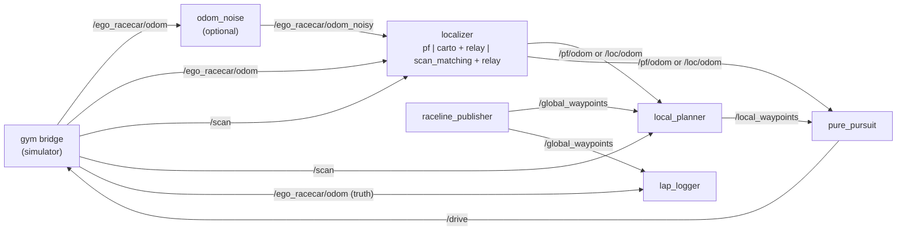

# 2. Architecture

## 2.1 Blocks

The stack is a chain of blocks connected by ROS 2 topics with fixed message types. Each
block is its own package.

| Block | When | Package(s) | Input → output |
|---|---|---|---|
| Mapping | once per track | `cartographer_slam` (+ `gap_follow` / `pid_wall` to drive) | scans + odometry → occupancy map + pose graph |
| Track extraction | once per map | `mapping_scripts` (offline) | map image → centreline + widths CSV |
| Global planning | once per map | `planning_scripts` (offline) → `global_planner` | centreline → raceline CSV → `/global_waypoints` |
| Localization | every run | `particle_filter` / `cartographer_slam` / `scan_matching` | scans + odometry (+ map) → pose |
| Local planning | every scan | `local_planner` | raceline + pose + scan → `/local_waypoints` |
| Control | every pose | `pure_pursuit` | path + pose → `/drive` |
| Evaluation | every run | `race_eval` | GT pose + raceline → logs, plots |
| Simulation runs | every run | `simulation_bringup` | scenario file → everything above, ordered, logged |

Helpers: `race_msgs` (raceline message), `odom_noise` (drifting odometry for simulation).

## 2.2 Online node graph

With `localization: gt` there is no localizer: the planner and controller use
`/ego_racecar/odom` directly.

## 2.3 Main topics

| Topic | Type | From → to |
|---|---|---|
| `/scan` | `sensor_msgs/LaserScan` (10 Hz) | simulator → localizers, local planner |
| `/ego_racecar/odom` | `nav_msgs/Odometry` (100 Hz) | simulator: ground truth; also used as perfect wheel odometry |
| `/ego_racecar/odom_noisy` | `nav_msgs/Odometry` | `odom_noise` → localizers |
| `/pf/odom` | `nav_msgs/Odometry` (100 Hz) | particle filter estimate → planner, controller |
| `/carto/pose`, `/scan_match/odom` | per-scan estimates | Cartographer / scan matching → `localization_relay` |
| `/loc/odom` | `nav_msgs/Odometry` (100 Hz) | `localization_relay` → planner, controller |
| `/global_waypoints` | `race_msgs/WaypointArray`, latched | raceline publisher → local planner, lap logger |
| `/local_waypoints` | `race_msgs/WaypointArray`, latched | local planner → pure pursuit |
| `/drive` | `ackermann_msgs/AckermannDriveStamped` | pure pursuit (or a reactive controller) → simulator |
| `/map`, `/carto_map` | `nav_msgs/OccupancyGrid`, latched | world map (simulator), stack map (bringup) |

"Latched" = reliable + transient local, depth 1: a node that starts later still gets the
message. Subscribers must use the same QoS.

## 2.4 Frames

| Frame | Meaning |
|---|---|
| `map` | the simulator's world frame; ground truth lives here |
| `carto_map` | the Cartographer map's frame; origin = car pose when mapping started |
| `odom` | odometry frame (only in the belief view, see below) |
| `ego_racecar/base_link` | the car (rear axle) |
| `ego_racecar/laser` | the LiDAR, 0.275 m ahead of `base_link` |

`map → carto_map` is a static transform (for Spielberg: x = 0, y = 0, yaw = −2.879). A
raceline optimised on the Cartographer map is in `carto_map`; nodes that receive a pose in
another frame convert it through TF.

### Truth and belief

In simulation two poses exist:

- **Truth**: the simulator's pose (`/ego_racecar/odom`), used by the physics and the
  simulated LiDAR, and logged by `lap_logger`.
- **Belief**: the localizer's estimate (`/pf/odom` or `/loc/odom`), used by the local
  planner and `pure_pursuit`.

`tf_source` selects which one places `base_link` in TF:

| View | TF tree | RViz |
|---|---|---|
| truth (default) | simulator publishes `map → base_link` | `base_link` at the ground-truth pose |
| belief | `map → carto_map → odom → base_link` (localizer + odometry, REP 105) | `base_link` at the estimate |

## 2.5 Structure

- The global raceline is computed offline (`planning_scripts`) and only published online
  (`global_planner`).
- The global planner and the local planner are separate nodes; the local planner reads the
  global raceline, the pose and the scan.
- The local planner's collision checks use the live scan only.
- `pure_pursuit` runs with fixed parameters (`config/pp_sim.yaml`) in all scenarios.
- Every raceline is checked for a minimum wall distance by the optimiser before it is written.
- The map is built in a separate mapping run and loaded frozen for racing.
- Algorithm modules have no ROS imports; the node files convert messages and call them.
- `simulation_bringup` starts a run from one config file, orders start-up by log events and
  writes node output to files.

## 2.6 Conventions

- Units in SI; ROS yaw convention (0 along +x, counter-clockwise positive); lateral
  offsets positive to the left.
- Every node's parameters are in a YAML file; launch files only override what they derive.
- Package READMEs document the full interface; algorithm details live next to the code.
